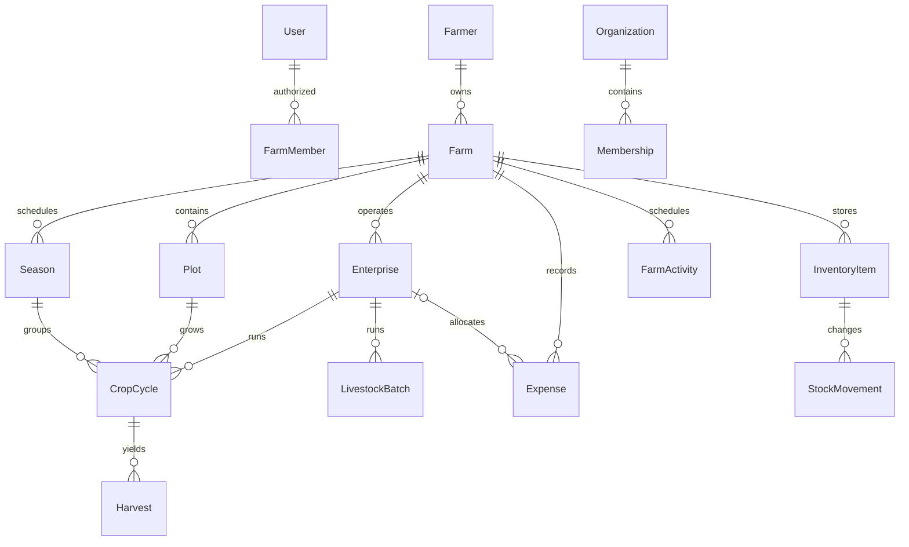

# Domain model

<!-- MYFARM-STATUS-START -->
- Documentation review: REVIEWED — Phase02 closeout; content and status updated from verified evidence; no completion inferred from review alone.
- Implementation status: PARTIALLY COMPLETE — Phase02 registry scope verified; Phase03 T001 Enterprise/Season foundation schema verified locally; no whole-document percentage claimed.
- Last reviewed: 2026-10-18 (Africa/Nairobi), Phase03 T005.
- Related phase/task IDs: Phase02 MYF-P02-T001–T013; later phases per roadmap.
- Verified completed work: Farmer, FarmerProfile, Farm, Plot, FarmMember implemented; User/Organization reused; Address/Contact as columns; Document deferred (D-P02-003).
- Remaining work/blockers: Phase03 crop-cycle contract and runtime persistence/API verified in T004/T005; crop UI, batch detail and later entities remain pending. Document awaits retention policy (P2-C5). [T002 evidence](../reports/phase-03-t002-2026-10-18.md).
- Evidence/report links: [Phase02 closeout](../reports/phase-02-closeout-2026-10-09.md); [Phase02 every-document review](../reports/phase-02-document-review-2026-10-09.md)
<!-- MYFARM-STATUS-END -->

## Phase 3 foundation subset — 2026-10-18

T001 adds Enterprise and Season to the existing farm scope, with actor/version metadata and composite farm/tenant foreign keys. Contracts describe crop/poultry parent relationships and reject mixed farm scopes. T002 adds verified local services/repositories and create/list/detail APIs for this subset. T003 adds authorized Enterprise/Season list, create and detail screens. T005 adds CropCycle/CropCatalog tables and crop runtime persistence; crop UI, LivestockBatch tables, movements and current-flock calculations remain pending. Full cycle acceptance is deferred under D-P03-007; [T003 evidence](../reports/phase-03-t003-2026-10-18.md). [T002 evidence and next task](../reports/phase-03-t002-2026-10-18.md).

## T004 crop-cycle domain contract

The validated command references one crop catalog entry, enterprise, plot and season, with optional variety, positive decimal-string area, explicit existing AreaUnit, planting/optional harvest dates and an optional recorded area-exception reason. Pure rules reject wrong parents, inactive catalog/production parents, unknown plot area and mixed units. Exact BigInt millionths sum all active plot allocations; only a recorded reason permits exceeding capacity. Forecast harvest does not release area. The standalone repository contract requires scoped reads and atomic authorized/serialized starts in T005; the CropCycle table and runtime repository are implemented in T005; [backend evidence](../reports/phase-03-t005-2026-10-18.md). [Evidence](../reports/phase-03-t004-2026-10-18.md).

**Proposed relationships and bounded domains.** Source entities/fields are preserved in the relevant phase F; support rows such as receipts, assignments and consent grants are recommendations.

User is authenticated principal; Farmer is agricultural identity/profile. Cardinality and agent-assisted onboarding remain Q05/Q23. FarmMember grants farm access; Organization Membership alone never grants private farmer history. Explicit sharing/assignment records control institutional use.

EnterpriseType is generic; a plot-linked CropCycle models seasonal/perennial crop choices after Q07. Poultry batch need not attach to a land plot. Current flock = opening + acquisitions − mortality − bird sales ± approved adjustments; eggs/feed tracked in separate units/events. Never decrement birds twice through production and inventory.

Accounting uses farm-required records with optional plot/enterprise/season/activity links. Sale revenue and PaymentRecord collections must not double-count. Receivable/Payable derives from obligation and allocations; future provider Payment is a different lifecycle. Stock source references link harvest/sales to one posting.

Later domains: organization procurement/order/reservation/collection; immutable wallet journal; consented economic snapshots/partner offers; private image assessment; lot lineage/custody; evaluated forecasts; entitlements. Add their tables in their phases, not because this diagram is written. [Phases](../MASTER-IMPLEMENTATION-ROADMAP.md), [multi-tenancy](multi-tenancy.md) and [financial rules](financial-integrity.md) govern ownership/integrity.

## Phase 2 implementation (2026-10-09)

Implemented Phase 2 subset ([closeout](../reports/phase-02-closeout-2026-10-09.md)):

- **Identity (Q05):** one Farmer per User, owned by a PERSONAL Organization ([D-P02-002](../DECISION-LOG.md#d-p02-002--q05-identity-model)). FarmerProfile holds the minimal contact/location fields ([D-P02-003](../DECISION-LOG.md#d-p02-003--q06-data-minimization)) with an optimistic `version`.
- **Farms:** Farm (owner farmer, optional acreage and GPS pair); Plot (unique name per farm, optional area with unit); FarmMember (OWNER).
- **Deferred:** Address and Contact are columns rather than tables; Document is deferred until a retention policy exists. Later-phase entities remain NOT STARTED.

## T005 stored crop model

CropCycle uses same-farm/tenant composite links to enterprise, plot and season; creator and global CropCatalog references; a creation-time crop label snapshot; optional variety/harvest; exact area and unit; recorded excess-area reason; ACTIVE/version 1 and actor/timestamps. Maize/Coffee are initial reference rows explicitly approved by the owner, with no runtime catalog write grant. Later catalog administration and livestock storage remain pending. [Evidence](../reports/phase-03-t005-2026-10-18.md).

## T007–T008 poultry batch model

A poultry batch belongs to one ACTIVE POULTRY enterprise on the farm (no plot or season link). It references a global animal-type catalog entry, stores an optional breed, a farmer label unique per farm ignoring case and spacing, a whole starting count from 0 up, an acquisition date and one of EGGS/MEAT/DUAL_PURPOSE/BREEDING (D-P03-010). The current count is reported as the starting count with source STARTING_COUNT until Phase 5 flock movements exist. [T007](../reports/phase-03-t007-2026-10-19.md), [T008](../reports/phase-03-t008-2026-10-19.md).
