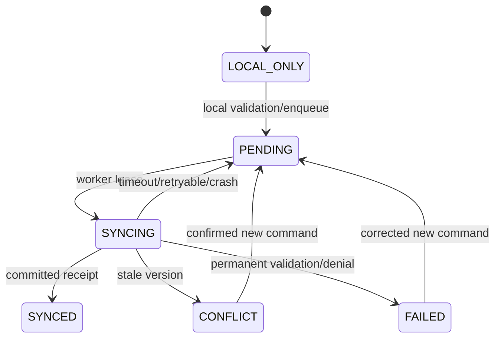

# Offline synchronization architecture

<!-- MYFARM-STATUS-START -->
- Documentation review: REVIEWED - affected Phase 15 scope, ownership, current access, ledger and connectivity behavior; historical evidence retained below.
- Implementation status: Phase 15 COMPLETED - 7/7 software tasks locally verified; conditional phase acceptance pending.
- Last reviewed: 2026-11-24 (Africa/Nairobi).
- Related phase/task IDs: MYF-P15-T001 through T007; D-P15-001 and D-P15-002; earlier references retained in dated sections.
- Verified completed work: Phase 15 acceptance, cumulative local quality/browser/integration, zero drift and actual recovery checks pass; see closeout for counts and limits.
- Remaining work/blockers: P15-C1 through C4; owner acceptance, hosted CI/rollout and inherited release conditions remain separate.
- Evidence/report links: [Phase 15 closeout](../reports/phase-15-closeout-2026-11-24.md).
<!-- MYFARM-STATUS-END -->

Offline farmer experience is mandatory by MVP Phase 8. Source P0456–P0479 requires expense/income/harvest/activity/task/photo recording and cached farm/record viewing; clientMutationId, deviceId, createdAt, updatedAt, syncStatus, version; six source states. Foundation prepares command boundaries, but complete sync is Phase 7.

## Proposed client/server contract

Local IndexedDB transaction persists draft/domain view and outbox together. Each intent gets stable clientMutationId, deviceId, local timestamps, actor/tenant partition, operation, entityId, schemaVersion, payload and baseVersion. Client identity fields are routing hints, never server authority. Reuse ID only for identical intent. Edit a rejected command by making a new ID referencing the prior one.

POST /api/v1/sync/push accepts a bounded batch. Server re-authenticates each command, validates related scope, locks/checks versions and atomically writes domain effects, scoped MutationReceipt with requestHash/result, audit and change-log. Unique (tenantId,actorId,clientMutationId) arbiters concurrent retries; compare payload hash before returning stored result. Duplicate HTTP calls are expected; exactly one domain effect is required.

Response per command: committed/replayed receipt, conflict with current authorized version, retryable failure, or permanent failure/denied. A lost response leaves queue pending; replay reads stored receipt, not a second transaction. Receipt retention must cover supported retry/offline window, or provide safe dedupe recovery before pruning (Q16).

GET /api/v1/sync/pull uses opaque authorized cursor with a transaction-consistent monotonic server change sequence. Return bounded pages and deletion tombstones. Record cache update plus cursor atomically. Client clocks never order changes. Expired cursor requires scoped full snapshot reconciliation that preserves pending commands and does not resurrect deletions. Pull sequence allocation/order must avoid skipped late commits (implementation proof required).

## State machine

Retry with bounded exponential backoff/jitter; honor server retry-after. Network flaps do not spawn duplicate workers. Multi-tab queue leases expire/recover; server receipt still provides ultimate dedupe. Foreground launch/online event/manual retry are required; background sync is optional browser enhancement, not guaranteed delivery.

Commands depending on locally-created parents order topologically or wait for receipt. Financial/stock entries append, never last-writer-wins. Editable notes/tasks use base-version conflict and explicit user reconciliation; no blind overwrite of money/stock. Insufficient authoritative stock after offline sale rejects visibly; local preview is provisional.

Photos persist BlobQueue metadata/blob then upload with stable ID/checksum after connectivity. Validate size/type/scope, obtain private upload grant, and finalize domain attachment only after verified object existence. Partial upload retries; orphan cleanup never deletes referenced files.

## Storage, privacy and recovery

Ask supported browser for persistence; denied permission is not a failure of all use, but durability is limited. Estimate quota and warn before writes. On QuotaExceededError rollback local save and show retry/export/sync guidance. Browser clearing/eviction/device loss can destroy never-synced records; **do not claim guaranteed recovery**. Distinguish last server sync and pending count. Approved encrypted/export recovery procedure is Q16, not implemented by documentation.

Local tenant/user partition and lock policy address shared phones. Logout protects cached access while preserving pending edits through explicit approved recovery; no accidental purge. Server rejects revoked scope on reconnect. SW updates/Dexie migrations must preserve pending outbox and support version skew.

Test eight actions offline/reload, quota denial, crash during write/sync, duplicate/concurrent/lost-ack replay, two-device edits, clock skew, parent dependency, tombstones/expired cursors, revoked memberships and photo partial failures. Meaningful offline duration/row/media limits must be measured on approved devices. [API](api-design-standards.md), [financial integrity](financial-integrity.md) and [testing](testing-strategy.md) define authoritative boundaries. Browser limitations follow [MDN storage](https://developer.mozilla.org/en-US/docs/Web/API/Storage_API/Storage_quotas_and_eviction_criteria), checked 2026-10-08.

Approved Q16 rules (D-P07-002 to D-P07-005): 14 days and 500 unsent entries per device, separate local data per account with no PIN, sign-out keeps unsent entries, and warnings plus an unencrypted download rather than any guarantee of recovery. Signed-in pages and API responses are never stored by the service worker; offline data lives only in the account's local database. [Plan](../reports/phase-07-start-2026-11-03.md).

Implemented differences from the proposal (D-P07-007): receipts stay in `AuditEvent` rather than a `MutationReceipt` table, with a check that refuses a key reused on another operation. Pull reuses the authorized list services with bounded snapshots rather than a change log with tombstones, because records are only appended or change status. There is no device registration: the device ID stays on the phone. Offline work happens on a static `/offline` shell, and the service worker never stores signed-in pages or API responses.

## Crash lease recovery correction - 2026-11-18

The phase audit reproduced a reload leaving an unexpired sending lease in IndexedDB. An exclusive same-account Web Lock proves the previous browser sender is gone, so a worker holding it now returns abandoned SYNCING entries to PENDING immediately before replay. Without Web Locks, recovery still waits for lease expiry. Mutation IDs, payloads, base versions and server duplicate receipts are preserved; the local queue version advances by the normal recovery transition; no database or IndexedDB migration. The failing queue-limit journey and a new explicit unexpired-lease regression pass in the focused offline browser suites. This does not measure real phones or close inherited field conditions. [Evidence](../reports/phase-11-12-transition-2026-11-18.md).

## Phase 12 staged implementation - 2026-11-20

Voice review/confirmation remains online. An open page retains typed details across connectivity loss; the saved draft ID in the URL resumes a private server review or completed receipt after refresh, without persisting raw words or confirmation consent. Uncertain financial responses retain the original grant and retry/recover the same outcome. Offline work uses the existing typed expense/outbox path; no voice outbox operation or IndexedDB migration is added. [Closeout and limitations](../reports/phase-12-closeout-2026-11-20.md).

## Phase 13 staged weather implementation - 2026-11-21

Six ephemeral synthetic forecast capabilities reuse current authorized farm/activity/crop services and approximate district context, never GPS or inferred stage. The weather page does not cache private responses or queue weather changes offline. A separately reviewed exact one-off spraying date change is server-validated, versioned and atomically audited, with current access checks after locks and DB-clock expiry. Dates and a payload digest remain in the existing immutable audit receipt; raw stage/forecast does not. Successful retries recover the same receipt; changed replays conflict. The additive manifest-listed weather runtime policy/trigger permits only the guarded scheduled date move and remains unapplied to hosted. Existing offline activity commands still use their original versions, so a stale version cannot silently overwrite the moved task. No new application table, external provider, paid service or live agronomic rule is introduced. [Closeout](../reports/phase-13-closeout-2026-11-21.md).

## Phase 14 local implementation - 2026-11-22

Named owner consent grants farm-specific officer permissions independently of FarmMember. Farmer-confirmed assisted registration commits exact reviewed records, assignment and audit receipts atomically. Current session/assignment/parent checks apply to visits, follow-ups, private namespaced media and sync. The existing account-partitioned outbox preserves denied work, with visible offline readiness and no IndexedDB version change. Six additive officer tables, column-limited guarded writes and composite parent constraints retain the shared runtime-role architecture; application queries enforce actor isolation. Local checks and recovery pass; hosted SQL/storage/application rollout and owner acceptance remain pending. [Scope, migrations, security evidence and limits](../reports/phase-14-closeout-2026-11-22.md).

## Phase 15 organization implementation - 2026-11-24

Institutional writes require online confirmation. Unreviewed offline inputs are explicitly unsaved. Exact reviewed commands are retained in actor/organization/form-partitioned tab sessionStorage before submission; storage failure prevents sending. A lost response locks editing until the same request recovers, and reload retains its request ID. Account changes remount the form and hide the prior actor review. No organization Dexie outbox, background replay or IndexedDB migration is added. Tab closure, storage eviction and device loss can lose recovery data; current revocation may refuse replay. Existing farmer/officer offline contracts remain unchanged. [Implementation, verification and release limits](../reports/phase-15-closeout-2026-11-24.md).
