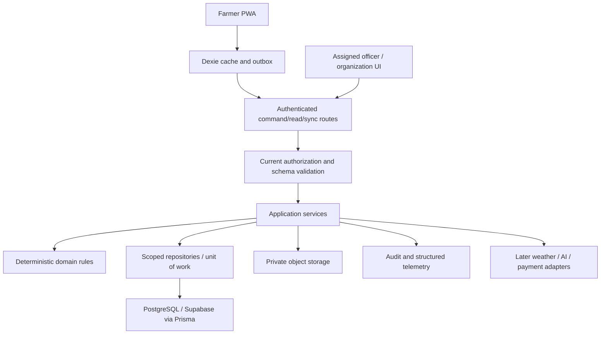

# System architecture

<!-- MYFARM-STATUS-START -->
- Documentation review: REVIEWED - Phase 12 task-relevant implementation, security/offline boundaries and evidence; historical sections preserved.
- Implementation status: REFERENCE ONLY - architecture record; Phase 12 test/text implementation verified locally below, with release conditions.
- Last reviewed: 2026-11-20 (Africa/Nairobi), Phase 12 task-relevant implementation review.
- Related phase/task IDs: MYF-P12-T003 through T010; D-P12-001 through D-P12-003; historical task references retained in the body.
- Verified completed work: Phase 12 approved test-adapter/text-fallback software and relevant exact-confirmation boundaries verified locally; no real speech or hosted claim.
- Remaining work/blockers: P12-C1 through C6 and inherited release conditions; real speech/language accuracy, hosted work and owner acceptance remain.
- Evidence/report links: [Phase 12 closeout](../reports/phase-12-closeout-2026-11-20.md); historical reports remain linked in their dated sections.
<!-- MYFARM-STATUS-END -->

Baseline required by source/request: Next.js App Router/React/TypeScript PWA, server application services/domain/repositories, Prisma and PostgreSQL/Supabase, Vercel, private object storage, Dexie/IndexedDB and custom sync. Proposed deployment is one modular application, not microservices.

Client owns entry, offline drafts, status and display. Server owns authority, tenant scope, calculations, version checks, atomic domain effects, receipt/audit/change-log. Database is authoritative; local data is cached or unacknowledged. Service worker caches the public app shell, not indiscriminate personalized server responses.

Proposed modules: identity/policy, registry, production, accounting, inventory, activities, sync, analytics, then later intelligence/assistant/voice/weather, officers/organizations/commerce/payments/profile/partners/vision/trace/forecasts/subscriptions/operations. Phase-specific slug directories are proposals; module ownership must be agreed before code. Modules expose application interfaces, not cross-module table access from UI.

Example expense flow: form schema → command with stable mutation ID → server auth/current FarmMember → validate enterprise/season scope → exact decimal rules → atomically expense + receipt + audit + change log → scoped result. Online and offline replay use the same command service.

Long external calls use durable intent/outbox plus reconciliation; no promise of in-memory background work completing after a serverless request. Add a durable worker/queue only where enabled provider workload needs one. [Stack](technology-stack.md), [database](database-architecture.md), [sync](offline-sync-architecture.md) and [ADRs](architecture-decisions.md) provide contracts.

## Phase1 implemented evidence and limits

Phase1 source implements UI → application → domain/contracts → scoped Prisma repository. Independent domain/provider boundary tests pass. Supabase auth/PG selected. Future accounting/stock functions are type-only interfaces; Dexie/service-worker/custom sync is not implemented.

[Closeout](../reports/phase-01-closeout-2026-10-08.md); [setup](../engineering/foundation-local-setup.md).

## Phase 2 implementation (2026-10-09)

Added module `src/modules/farmer-registry/` (domain rules → contracts/ports → `FarmerRegistryService` → Prisma repository), API routes under `src/app/api/v1/`, and pages `/farmer`, `/farms` with a signed-in registry navigation. It follows the Phase 1 layering and boundary check; no new dependency ([closeout](../reports/phase-02-closeout-2026-10-09.md)).

## Phase 3 T003 UI (2026-10-18)

Enterprise/Season list, create and detail pages are server-rendered within the named farm scope. Server actions reuse the authorized production application service; shared safe command feedback redirects only after commit. Client forms reuse existing UI, React Hook Form and Zod. Request IDs survive interrupted responses while the open form retains its normalized payload; changed payloads start a new intent. Offline saving is disabled, with explicit in-memory retention limits. No durable outbox or new dependency is introduced. Full cycle acceptance remains deferred under D-P03-007. [Evidence](../reports/phase-03-t003-2026-10-18.md).

## Phase 3 T005 backend (2026-10-18)

CropCycleService reuses extracted production farm authorization; its lazy repository adapter keeps anonymous requests ahead of database client creation. Crop writes claim the existing audit receipt, serialize capacity per plot inside the transaction, recheck rights and commit the validated cycle atomically. Private JSON list/detail/catalog/start routes use the established HTTP wrappers. Catalog reference data is global; farm records remain scoped and browser roles have no direct data grants. No new dependency or external service is introduced. [Evidence](../reports/phase-03-t005-2026-10-18.md).

## Phase 3 T012 capability presentation (2026-10-25)

Enterprise list/detail screens and both production selectors consume the authorized T011 workflow capability. `EnterpriseWorkflow` contains presentation for supported workflow IDs; it does not map enterprise types to workflows. `enterpriseChoice` shares labels and disabled states across initial, paginated and preset choices. Unsupported or closed presets are visible but not preselected for submission. Existing page guards, server actions and start-service authorization remain authoritative; form drafts, retries and feedback reuse the existing production components. No application-service, persistence, provider, dependency or schema change is required. [Implementation and acceptance evidence](../reports/phase-03-t012-2026-10-25.md).

## Phase 12 staged implementation - 2026-11-20

Voice input is a bounded read-only service with provider-independent ports and strict suggestion output. A separate authorized draft/confirmation service applies deterministic accounting validation and commits expense, confirmation state and receipts atomically. The review UI composes the existing expense form, choices and formatting. Synthetic marker transcription and example parsing demonstrate the adapter flow; real speech registrations remain empty and manual text fallback is explicit. [Closeout and limitations](../reports/phase-12-closeout-2026-11-20.md).

## Phase 13 T001 staged domain - 2026-11-20

Weather intelligence starts with pure validated synthetic forecasts and context, a clock-injected task evaluator and a test adapter port carrying only a coarse location key. It reuses current activity labels, farm-calendar dates and scope consistency checks; a notice cannot write or reschedule an activity. Missing/stale/mismatched evidence yields an explicit limitation. Current membership and crop/task parent resolution remain T002 service responsibilities. No schema, network provider, live agronomic rule or UI is introduced. [Evidence](../reports/phase-13-t001-2026-11-20.md).

## Phase 13 staged weather implementation - 2026-11-21

Six ephemeral synthetic forecast capabilities reuse current authorized farm/activity/crop services and approximate district context, never GPS or inferred stage. The weather page does not cache private responses or queue weather changes offline. A separately reviewed exact one-off spraying date change is server-validated, versioned and atomically audited, with current access checks after locks and DB-clock expiry. Dates and a payload digest remain in the existing immutable audit receipt; raw stage/forecast does not. Successful retries recover the same receipt; changed replays conflict. The additive manifest-listed weather runtime policy/trigger permits only the guarded scheduled date move and remains unapplied to hosted. Existing offline activity commands still use their original versions, so a stale version cannot silently overwrite the moved task. No new application table, external provider, paid service or live agronomic rule is introduced. [Closeout](../reports/phase-13-closeout-2026-11-21.md).
